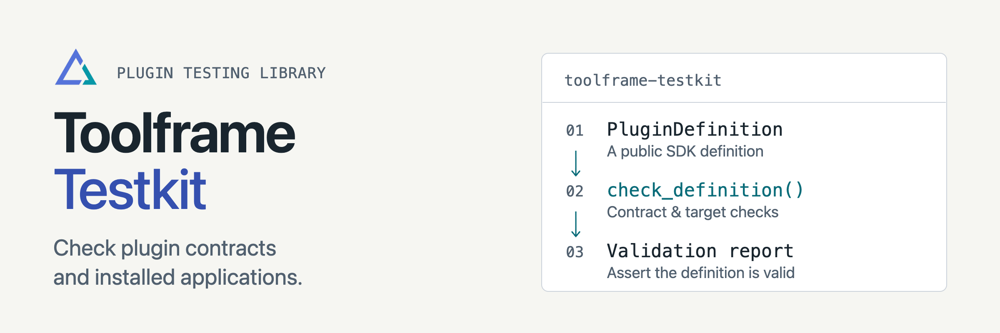

<p align="center">
<picture>
  <source media="(prefers-color-scheme: dark)" srcset="docs/assets/readme-banner-dark.png">
  <source media="(prefers-color-scheme: light)" srcset="docs/assets/readme-banner-light.png">
  
</picture>
</p>

# Toolframe Testkit

[](https://github.com/toolframe/toolframe-testkit/actions/workflows/ci.yml?query=branch%3Amain)

Check plugin contracts and test installed Toolframe applications through public CLI and HTTP APIs.
Use it as a development dependency in your plugin test suite.

## Quick start

Use Python 3.14+ in your plugin's test environment:

```sh
python -m pip install 'toolframe-testkit[pytest]==0.2.1'
```

Import your plugin's exported definition and validate it:

```python
from toolframe_testkit import check_definition
from my_plugin.definition import plugin


def test_plugin_contract():
    check_definition(plugin).assert_valid()
```

Replace `my_plugin.definition` with your package's module, then run `pytest`.
The SDK is installed as a dependency. For installed-application tests, follow the
[harness guide](docs/harness.md) and explicitly enable the pytest integration.

**Scope:** Testkit does not install Core or load a pytest plugin automatically.
You select the Core command and private test home. Contract checks validate
definitions and supplied examples; browser flows, provider protocols and external
services need separate acceptance tests.

## Guides

| I want to… | Start here |
| --- | --- |
| Validate definitions and examples | [Contract checks](docs/contracts.md) |
| Exercise a running application | [Application harness](docs/harness.md) |
| See a complete scenario | [Installed-application example](examples/installed_application.py) |
| Contribute or run checks | [Contributing](CONTRIBUTING.md) · [Verification](docs/development.md) |
| Publish a package | [Releasing](docs/releasing.md) |

[Releases](https://github.com/toolframe/toolframe-testkit/releases)

## License

[Apache 2.0](LICENSE).
